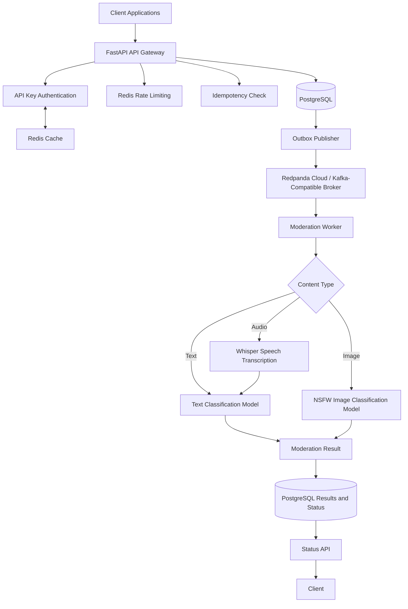

# 🛡️ ModeraShield — Asynchronous Content Moderation Platform

An asynchronous content moderation platform built with **FastAPI, PostgreSQL, Redis, Kafka-compatible messaging, and locally executed machine learning models**.

ModeraShield accepts moderation requests through a REST API, persists requests and outbox events, and uses background workers to process supported text, image, and audio inputs. It explores practical backend engineering concepts including API-key authentication, rate limiting, idempotency, transactional outbox patterns, asynchronous processing, and performance testing.

> **Project status:** Deployed API and performance-tested. The latest recorded load test achieved approximately **14.52 requests per second** with 100 concurrent users and a 0% reported HTTP failure rate. The 58 RPS target has not been achieved. Live background-worker deployment must be verified separately.

## ✨ Features

- **REST API:** Submit content for moderation through FastAPI.
- **API-key authentication:** Authenticate clients and associate requests with tenants.
- **Redis-backed rate limiting:** Enforce configured request limits.
- **API-key caching:** Reduce repeated authentication database lookups when the cache implementation is active.
- **Idempotency support:** Help prevent duplicate request processing.
- **Transactional outbox:** Persist moderation requests and outbox events in PostgreSQL.
- **Asynchronous event processing:** Publish outbox events to a Kafka-compatible broker.
- **Background workers:** Process supported moderation requests outside the API request lifecycle.
- **Three ML inference paths:** Text classification, image classification, and audio transcription followed by text classification.
- **PostgreSQL persistence:** Store requests, moderation results, and associated metadata.
- **Request status API:** Retrieve the latest stored status and result.
- **Load testing:** Evaluate API throughput, response latency, and HTTP failures using Locust.

## 🏗️ Architecture

### High-level architecture



### Components

| Component | Responsibility |
|---|---|
| FastAPI | Request validation, authentication, rate limiting, and request creation |
| PostgreSQL | Persistent storage for tenants, API keys, moderation requests, results, and outbox events |
| Redis | API-key caching and rate limiting |
| Outbox publisher | Publishes persisted outbox events to the broker |
| Redpanda Cloud | Kafka-compatible event messaging |
| Moderation worker | Consumes events, dispatches inference handlers, and persists results |
| Hugging Face Transformers | Loads the configured models and prepares inference inputs |
| PyTorch | Executes model inference locally |
| Locust | Generates concurrent requests for load testing |
| Render | Hosts the deployed API and database infrastructure |

### Request lifecycle

1. A client submits content to the moderation API with an API key and an idempotency key.
2. The API validates the request and authenticates the tenant.
3. Redis-backed rate limiting checks the configured request allowance.
4. The application checks idempotency and creates a moderation request.
5. The moderation request and its outbox event are persisted in PostgreSQL.
6. The API returns `201 Created` with request information in the current implementation.
7. The outbox publisher publishes eligible events to the Kafka-compatible broker.
8. The moderation worker consumes events and claims requests for processing.
9. The worker dispatches the request to the appropriate inference handler.
10. The moderation result and request status are persisted in PostgreSQL.
11. The client retrieves the latest stored status and result through the status API.

### Why the transactional outbox pattern?

The outbox pattern helps prevent a consistency problem in which a database request is saved but the corresponding event is never recorded for publication.

ModeraShield persists the request and outbox event together, then uses a separate publisher to deliver events to the broker. This decouples API request handling from event publication and provides a basis for retrying unpublished events.

The outbox pattern does not guarantee exactly-once processing by itself. Consumers must account for possible duplicate event delivery, and failure recovery must be designed explicitly.

## 🤖 AI Models and Moderation Pipeline

ModeraShield implements three local ML inference paths using **PyTorch and Hugging Face Transformers**. Model weights and associated artifacts are loaded through Hugging Face; inference runs on CUDA when available or CPU otherwise.

No external hosted inference API calls were identified in the repository's moderation execution path.

### Model inventory

| Model | Modality | Purpose | Execution |
|---|---|---|---|
| [`bhavdeepsingh/moderashield-text-moderation`](https://huggingface.co/bhavdeepsingh/moderashield-text-moderation) | Text | Multi-label content moderation | Local PyTorch/Transformers |
| [`Falconsai/nsfw_image_detection`](https://huggingface.co/Falconsai/nsfw_image_detection) | Image | NSFW image classification | Local PyTorch/Transformers |
| [`openai/whisper-tiny`](https://huggingface.co/openai/whisper-tiny) | Audio | Speech-to-text transcription before text moderation | Local PyTorch/Transformers |

The image and audio models are configurable through environment variables. The text model ID is configured in the inference implementation.

**Note:** `openai/whisper-tiny` is a model distributed through Hugging Face and executed locally. It does not mean the application calls the OpenAI API.

### 1. Text moderation

**Model:** `bhavdeepsingh/moderashield-text-moderation`

The text pipeline uses a sequence-classification model to evaluate submitted text.

Processing steps:

1. Tokenize the input with truncation and padding.
2. Limit the input sequence to a maximum of 256 tokens.
3. Run the classification model to obtain logits.
4. Apply sigmoid to produce per-label scores.
5. Compare each score against its corresponding threshold.
6. Return moderation categories, scores, and a flagged/not-flagged decision.

The model's label map and thresholds are downloaded from its Hugging Face repository. The checked-in label and threshold JSON files are empty, so the actual label names and threshold values cannot currently be verified from those files.

The stored model identifier is currently `moderashield-text-v1`, which differs from the Hugging Face repository ID. This attribution should be standardized.

### 2. Image moderation

**Default model:** `Falconsai/nsfw_image_detection`

The image pipeline classifies images for NSFW content.

Processing steps:

1. Validate and decode the uploaded image.
2. Convert it to RGB.
3. Prepare input tensors using the image processor.
4. Execute the image-classification model locally.
5. Apply softmax to obtain class probabilities.
6. Flag the image when its `nsfw` score meets or exceeds the configured threshold.

The default threshold is `0.5`, configurable through `IMAGE_MODERATION_THRESHOLD`.

Additional settings constrain permitted image formats, dimensions, and pixel counts.

### 3. Audio moderation

**Default transcription model:** `openai/whisper-tiny`

Audio moderation uses a two-stage pipeline. Whisper transcribes the audio, and the text moderation model evaluates the resulting transcript.

Processing steps:

1. Validate and decode the audio input.
2. Prepare mono audio at 16 kHz.
3. Generate Whisper input features.
4. Run local speech transcription.
5. Pass a non-empty transcript to the text moderation model.
6. Persist the moderation decision and associated metadata.

Whisper performs transcription, not moderation classification.

Empty or near-silent audio can return an empty transcript before model inference. The current handler's model attribution for this edge case should be treated cautiously because the stored identifier may imply inference occurred when it was skipped.

### Model limitations

- Video requests can be accepted by the API, but no video inference handler is registered. Video moderation is not currently supported.
- No LLM, embedding model, reranker, or remote hosted-inference provider was identified in the verified moderation execution path.
- No alternate model or provider failover is implemented.
- CPU selection when CUDA is unavailable is a device fallback, not a model fallback.
- Exact Hugging Face model revisions are not pinned in the repository.
- Text-model labels and thresholds need better versioning and documentation.

## 🧰 Technology Stack

| Layer | Technology | Purpose |
|---|---|---|
| Language | Python | API, workers, and inference |
| API framework | FastAPI | REST endpoints and validation |
| ASGI server | Uvicorn | Serving the API |
| Database | PostgreSQL | Persistent storage |
| ORM | SQLAlchemy | Database access and session management |
| Cache | Redis | API-key caching and rate limiting |
| Messaging | Redpanda Cloud / Kafka-compatible broker | Asynchronous event delivery |
| ML framework | PyTorch | Model inference |
| ML libraries | Hugging Face Transformers | Model loading and inference preparation |
| Image processing | Pillow | Image decoding and preprocessing |
| Audio processing | Audio decoding and feature preparation libraries | Audio validation and preprocessing |
| Load testing | Locust | Concurrent API performance tests |
| Deployment | Render | Hosted API and database infrastructure |

## 🌐 Live Deployment

| Resource | URL |
|---|---|
| Live API | [moderashield-api.onrender.com](https://moderashield-api.onrender.com) |
| Health check | [GET /health](https://moderashield-api.onrender.com/health) |
| Interactive API documentation | [Swagger UI — /docs](https://moderashield-api.onrender.com/docs) |
| Source code | [GitHub repository](https://github.com/Bhavdeepsingh7/moderaShield) |

The health endpoint is expected to return:

```json
{
  "status": "ok"
}
```

### Deployment caveat

The checked-in Docker Compose configuration starts PostgreSQL, Kafka, and Redis, while the API Dockerfile starts Uvicorn. The supplied deployment configuration does not start the outbox publisher or moderation worker.

Consequently, a running API does not by itself prove that requests are being processed by the ML models. The background services must be deployed and configured separately for the complete asynchronous pipeline to operate.

The free-tier deployment may also experience cold starts, constrained CPU and memory, database connection limits, and network latency.

## 🚀 Getting Started

### Prerequisites

Install or configure:

- Python 3.11 or another version supported by the project dependencies.
- Git.
- PostgreSQL.
- Redis.
- Access to a Kafka-compatible broker, such as Redpanda Cloud.
- Network access to download model weights from Hugging Face on first use.
- A compatible PyTorch environment. CUDA is optional.

### 1. Clone the repository

```bash
git clone https://github.com/Bhavdeepsingh7/moderaShield.git
cd moderaShield
```

### 2. Navigate to the API service

```bash
cd services/api-gateway
```

### 3. Create a virtual environment

**Windows — PowerShell**

```powershell
python -m venv .venv
.\.venv\Scripts\Activate.ps1
```

**Linux / macOS**

```bash
python3 -m venv .venv
source .venv/bin/activate
```

### 4. Install dependencies

If the project contains a `requirements.txt` file:

```bash
pip install -r requirements.txt
```

Otherwise, use the dependency manifest actually present in the repository.

For GPU inference, install a PyTorch build compatible with your CUDA environment. CPU inference is supported when CUDA is unavailable.

### 5. Configure environment variables

Create a local `.env` file in the API service directory, using the names expected by the application configuration.

Example:

```dotenv
ENVIRONMENT=development

DATABASE_URL=<your-postgresql-connection-string>
REDIS_URL=<your-redis-connection-string>

MODERASHIELD_API_KEY=<your-api-key>

RATE_LIMIT_REQUESTS=3480
RATE_LIMIT_WINDOW_SECONDS=60

IMAGE_MODERATION_MODEL=Falconsai/nsfw_image_detection
IMAGE_MODERATION_THRESHOLD=0.5

AUDIO_TRANSCRIPTION_MODEL=openai/whisper-tiny
AUDIO_TRANSCRIPTION_DEVICE=auto
```

This is a representative configuration, not a complete list of every required setting. Check `app/core/config.py`, the broker configuration, and `.env.example` for the exact names and defaults used by your checkout.

The text model ID is configured in the inference implementation rather than through the model environment variables shown above.

**Never commit real API keys, database credentials, or broker credentials to GitHub.**

### 6. Start the API

From `services/api-gateway`:

```bash
uvicorn app.main:app --host 0.0.0.0 --port 8000
```

The API should be available at:

- Base URL: `http://localhost:8000`
- Health check: `http://localhost:8000/health`
- Interactive documentation: `http://localhost:8000/docs`

### 7. Start the background services

Run each process in a separate terminal, with the virtual environment activated and the required configuration available.

**Terminal 1 — API**

```bash
uvicorn app.main:app --host 0.0.0.0 --port 8000
```

**Terminal 2 — Moderation worker**

```bash
python -m app.workers.moderation_worker
```

**Terminal 3 — Outbox publisher**

```bash
python -m app.workers.outbox_publisher
```

Ensure that PostgreSQL, Redis, and the configured broker are reachable before starting the complete pipeline.

Model weights may need to be downloaded on first inference. Initial model loading can therefore take longer than subsequent requests.

## 🔑 API Documentation

### Authentication

Protected endpoints use an API key in the `X-API-Key` request header.

```http
X-API-Key: YOUR_API_KEY
```

Keep API keys private. Do not place production keys in frontend code, public repositories, screenshots, or shared logs.

### Submit a text moderation request

**Endpoint**

```http
POST /api/v1/moderate/
```

Example:

```bash
curl -X POST "https://moderashield-api.onrender.com/api/v1/moderate/" \
  -H "Content-Type: application/json" \
  -H "X-API-Key: YOUR_API_KEY" \
  -H "Idempotency-Key: unique-request-123" \
  -d '{
    "content_type": "text",
    "content": "I enjoy helping people and building useful software applications."
  }'
```

| Field | Description |
|---|---|
| `content_type` | Content type; the example uses `text`. |
| `content` | Content submitted for moderation. |
| `X-API-Key` | Authentication header identifying the API client. |
| `Idempotency-Key` | Identifies a logical request for duplicate-request protection. |

The exact request schema, validation rules, and idempotency behavior are defined by the application.

### Submit a media moderation request

**Endpoint**

```http
POST /api/v1/moderate/media
```

This endpoint accepts media submissions according to its implemented validation rules and maps supported media types to content types.

The inference registry currently supports **text, image, and audio**. Although video content types may be accepted at the API layer, the worker has no video inference handler, so video moderation is not supported.

Inspect `/docs` for the exact media upload format and required parameters.

### Response

The current request-creation endpoint returns `201 Created` when a moderation request is created. This is the observed implementation behavior; it should not be confused with a claim that asynchronous moderation has completed.

Inspect the response schema in `/docs` for the exact returned fields and request ID.

### Retrieve moderation status

**Endpoint**

```http
GET /api/v1/moderate/{request_id}
```

Example:

```bash
curl "https://moderashield-api.onrender.com/api/v1/moderate/YOUR_REQUEST_ID" \
  -H "X-API-Key: YOUR_API_KEY"
```

This endpoint retrieves the latest stored state and result for the specified request.

The worker updates the request status after processing. Clients should use the actual status values and response schema defined by the implementation.

### Interactive documentation

Explore available routes, headers, schemas, and responses:

[Open the ModeraShield Swagger UI](https://moderashield-api.onrender.com/docs)

## ⚙️ Configuration and Reliability

### Rate limiting

The current configuration includes:

```dotenv
RATE_LIMIT_REQUESTS=3480
RATE_LIMIT_WINDOW_SECONDS=60
```

This corresponds to 3,480 requests per 60-second window, or an average of 58 requests per second if requests are distributed uniformly.

This configuration does **not** guarantee 58 RPS of sustained throughput, nor does it necessarily enforce a strict per-second limit. Actual capacity depends on API processing, database access, inference workers, and deployment resources.

### Database connection pooling

The API SQLAlchemy engine is configured with:

```python
pool_size=20
max_overflow=10
pool_timeout=15
pool_pre_ping=True
pool_recycle=1800
```

This permits up to 30 checked-out connections per engine pool. Separate API and worker processes can each create their own pool, so total connection demand must be considered against the database connection limit.

### API-key caching

Redis caching can reduce repeated database lookups during authentication. The implementation should be evaluated for:

- Short cache TTLs.
- Cache keys that do not expose raw API keys.
- Invalidation after revocation, rotation, or disablement.
- Defined behavior during Redis outages.
- Correct handling of cache misses and expired entries.

The presence of a caching implementation does not by itself prove a performance improvement; that requires measurements.

### Failure handling

The worker retries processing failures up to three times before marking a request as failed, according to the inspected implementation. These retries repeat the same model call rather than switching to a fallback model.

The system should also be monitored for:

- Unpublished outbox events.
- Broker consumer lag.
- Stuck or repeatedly failing requests.
- Database pool exhaustion.
- Model-loading and inference errors.
- Retry counts and processing latency.

## 📊 Performance Testing

ModeraShield was load-tested against the deployed API using [Locust](https://locust.io/).

### Latest recorded benchmark

| Metric | Result |
|---|---:|
| Concurrent users | 100 |
| Spawn rate | 10 users/second |
| Test duration | 60 seconds |
| Total HTTP requests | 865 |
| Average throughput | 14.52 requests/second |
| HTTP failure rate | 0% |
| Average response time | 5.945 seconds |
| Median response time | 6.2 seconds |
| 95th-percentile response time | 8.1 seconds |
| Maximum response time | 8.835 seconds |

### Interpretation

- The test recorded 865 HTTP requests without reported HTTP failures.
- Throughput plateaued at approximately 14.5 RPS.
- Average and tail latency increased substantially under high concurrency.
- The results suggest a capacity bottleneck, but they do not identify the exact source by themselves.
- HTTP success does not prove that every request was moderated successfully.
- End-to-end request completion, outbox publication, worker processing, and final stored statuses must be checked separately.

### Performance target

| Metric | Value |
|---|---:|
| Target throughput | 58 RPS |
| Latest measured throughput | 14.52 RPS |
| Approximate target achieved | 25% |

The 58 RPS figure is a target, not an achieved benchmark.

Further optimization should begin with profiling database latency, connection-pool wait time, Redis latency, broker lag, worker throughput, and end-to-end completion rates.

### Run a Locust test

Install Locust if necessary:

```bash
pip install locust
```

Set your API key in PowerShell without hardcoding it into the test file:

```powershell
$env:MODERASHIELD_API_KEY = Read-Host "Enter your ModeraShield API key"
```

Run the test from the directory containing `locustfile.py`:

```powershell
python -m locust -f locustfile.py `
  --host https://moderashield-api.onrender.com `
  --users 100 `
  --spawn-rate 10 `
  --run-time 60s `
  --headless
```

Replace the host with `http://localhost:8000` for a local API.

Run load tests only against infrastructure you own or are authorized to test. Avoid excessive load against limited free-tier services.

## 📁 Project Structure

The following illustrates the principal files identified during the repository audit. Additional modules, schemas, models, migrations, tests, and configuration files may exist.

```text
moderaShield/
└── services/
    └── api-gateway/
        └── app/
            ├── main.py
            ├── core/
            │   └── config.py
            ├── db/
            │   └── session.py
            ├── dependencies/
            │   ├── auth.py
            │   └── database.py
            ├── repositories/
            │   └── api_key_repository.py
            ├── services/
            │   └── moderation_service.py
            ├── moderation/
            │   ├── ml_engine.py
            │   ├── engine.py
            │   ├── label_map.json
            │   └── thresholds.json
            └── workers/
                ├── moderation_worker.py
                └── outbox_publisher.py
```

The inference handlers are located under `app/services/inference/`, including the text, image, audio, and registry modules.

## 🔒 Security Considerations

- Authenticate protected endpoints using API keys.
- Associate requests with the correct tenant.
- Keep secrets in environment variables or a dedicated secrets manager.
- Never commit credentials or production database URLs.
- Avoid logging raw API keys or sensitive submitted content.
- Use appropriate database access controls.
- Apply rate limiting to reduce abuse.
- Test idempotency behavior and duplicate-event handling.
- Define retention and deletion policies for submitted content and moderation results.
- Restrict access to PostgreSQL, Redis, and the messaging broker.

These are security considerations, not a claim that a full security audit has been completed.

## 🧪 Release Checklist

- [ ] Health endpoint responds successfully.
- [ ] Valid API keys can submit requests.
- [ ] Invalid and revoked API keys are rejected.
- [ ] Rate limits are enforced correctly.
- [ ] Idempotency behavior is tested.
- [ ] Request and outbox records are persisted consistently.
- [ ] The outbox publisher is deployed and running.
- [ ] The moderation worker is deployed and running.
- [ ] Text inference returns expected labels and scores.
- [ ] Image inference returns expected class scores.
- [ ] Audio transcription and transcript moderation work correctly.
- [ ] Unsupported video requests fail predictably.
- [ ] Final moderation statuses are verified after load tests.
- [ ] Model IDs, revisions, labels, and thresholds are documented accurately.
- [ ] Secrets are excluded from version control.

## 🛣️ Future Improvements

- [ ] Pin model revisions and verify downloaded model artifacts.
- [ ] Document the text classifier's labels and per-label thresholds.
- [ ] Standardize the persisted model identifiers.
- [ ] Add structured logs and request correlation IDs.
- [ ] Add metrics for request latency, inference duration, and worker throughput.
- [ ] Monitor outbox backlog and broker lag.
- [ ] Add automated integration tests for the complete asynchronous pipeline.
- [ ] Add more robust failure recovery and dead-letter handling.
- [ ] Profile database queries and connection-pool waits.
- [ ] Measure end-to-end moderation completion rates under load.
- [ ] Add deployment configuration for the API, outbox publisher, and moderation worker.
- [ ] Implement video moderation if it becomes a product requirement.
- [ ] Improve model evaluation and document moderation quality metrics.

## 🎯 Engineering Concepts Demonstrated

ModeraShield explores practical concepts in:

- REST API design and request validation.
- API-key authentication and tenant-aware access.
- Redis-backed caching and rate limiting.
- PostgreSQL transactions and SQLAlchemy connection pooling.
- Idempotency and duplicate-request protection.
- Transactional outbox architecture.
- Kafka-compatible asynchronous messaging.
- Background processing and request state management.
- Local ML inference with PyTorch and Hugging Face Transformers.
- Text, image, and audio processing pipelines.
- Concurrent load testing and performance analysis.
- Capacity constraints in free-tier deployments.

## 👨‍💻 Author

**Bhavdeep Singh**

B.Tech in Information Technology, IIIT Una

- GitHub: [Bhavdeepsingh7](https://github.com/Bhavdeepsingh7)
- Project: [ModeraShield](https://github.com/Bhavdeepsingh7/moderaShield)

---

*ModeraShield is an engineering project exploring content moderation, local machine learning inference, asynchronous processing, and distributed backend systems. Performance results reflect a specific recorded test and do not guarantee production capacity or moderation quality.*
